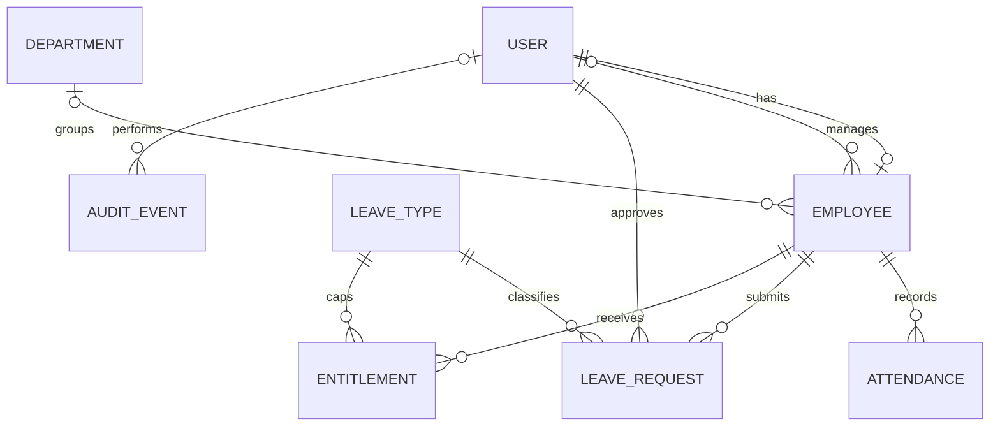

# Database schema and ERD

Django migrations are the authoritative executable schema: `Source Code/hr/migrations/0001_initial.py`. Run `python manage.py sqlmigrate hr 0001` for SQL targeting your configured database. Django auth, sessions, contenttypes and admin tables are created by their own bundled migrations.

| Entity | Key fields and constraints |
|---|---|
| User | AbstractUser, username unique, email unique, role enum, active/superuser flags; hashed password |
| Employee | Unique user one-to-one; unique employee_id; department and manager protected FKs; joined date, job/contact details |
| Department | Unique name |
| LeaveType | Unique name; limited and active flags |
| Holiday | Unique date and descriptive name |
| Entitlement | Unique employee/type/year; nonnegative integer days |
| LeaveRequest | Protected employee/type/approver/decider FKs; date order check; positive days; status, reason, decision note/time; composite employee/status/start index |
| Attendance | Unique employee/date; clock-out >= clock-in or null; protected employee FK |
| AuditEvent | Protected actor FK, action, target string, detail, timestamp; no mutation endpoint |
| EmailNotification | Recipient/subject/body, sent timestamp, attempts and sanitized error; durable queue in same database transaction as leave action |

Foreign keys carry indexes by default. Employee locks serialize service-level submissions, cancellations and approvals on PostgreSQL. Balance is derived from entitlement less pending/approved requests, so a separate mutable balance counter cannot drift. Admin edits to entitlements can lower allowances below committed usage; approval rechecks balance and blocks if negative. HR should not lower allowances below already committed days.

Email queue records are intentionally independent snapshots, so changes to an account email after submission do not reroute a previously queued message. On deactivation, review any queued messages to that person's former address using your controlled operational process.
